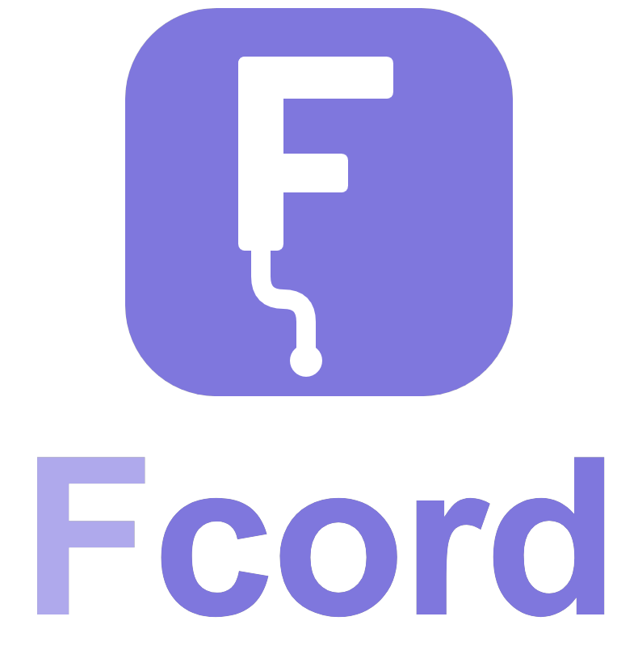

# FCord

FCord adds a configurable plugin catalog, themes, profile customization and optional media tools to the official Discord desktop client on Windows. Developed by [Fahd](https://github.com/ellecrydansmesdm).

[Download FCord 1.6.0 for Windows x64](https://github.com/ellecrydansmesdm/Fcord/releases/download/v1.6.0/FCord-Setup-1.6.0.exe) · [Release notes](https://github.com/ellecrydansmesdm/Fcord/releases/tag/v1.6.0) · [Website](https://fhubcore.dev/fcord) · [Community support](https://discord.gg/W2YgEStqJ4)

## Current release

FCord **1.6.0** (November 24, 2026) is a feature and performance release. LoudMicKit no longer downloads any voice module: its tiers are rebuilt on your PC from your own Discord's official module and checked byte for byte, and its 49 Equalizer APO presets and 2026 guide ship with FCord. More than 150 plugins are ported or repaired, global mute, deafen and push-to-talk shortcuts work while Discord is in the background, and FCord restarts in safe mode after two quick crashes. Measured against 1.5.1 on the same Discord and account, FCord uses about 330 MB less memory after a session, switches channels faster (p95 863 → 594 ms) and recalculates styles far less while idle (248 → 48 ms per 30 s). Agrims Hook and the old Voice Playground downloads are removed for safety.

| Available asset | Purpose |
| --- | --- |
| [FCord-Setup-1.6.0.exe](https://github.com/ellecrydansmesdm/Fcord/releases/download/v1.6.0/FCord-Setup-1.6.0.exe) | Windows x64 installer with Install, Repair and Uninstall |
| [fcord-dist.zip](https://github.com/ellecrydansmesdm/Fcord/releases/download/v1.6.0/fcord-dist.zip) | Windows x64 payload used by the installer and the in-client updater |
| [checksums.txt](https://github.com/ellecrydansmesdm/Fcord/releases/download/v1.6.0/checksums.txt) | SHA-256 hashes of the release files |
| [release-manifest.json](https://github.com/ellecrydansmesdm/Fcord/releases/download/v1.6.0/release-manifest.json) | Ed25519-signed update metadata |
| [download-manifest.json](https://github.com/ellecrydansmesdm/Fcord/releases/download/v1.6.0/download-manifest.json) | Machine-readable download selection |

SHA-256 of `FCord-Setup-1.6.0.exe`: `25bcacb718342aa58b963cde057b5252942a6b98a0368fb861d335e27f1b0692`

FCord 1.6.0 is published for Windows 10 and 11 (x64) only. No macOS, Linux, ARM64 or browser package is part of this release. Older packages remain attached to their original releases; they are not maintained.

## Install or repair

1. Install the official Discord channel you use, and open it once. Stable, Canary and PTB are supported.
2. Close that Discord channel. Other Discord channels can stay open.
3. Download the installer above and compare its SHA-256 with `checksums.txt`.
4. Run Setup, select the Discord channel, then choose **Install**. Use **Repair** for an existing FCord installation, including after an official Discord update.
5. Open Discord and find FCord in User Settings.

The installer requires Microsoft Edge WebView2. The release manifests are Ed25519-signed; the Windows executable has no Authenticode signature, so Windows SmartScreen shows an "unknown publisher" prompt the first time (**More info**, then **Run anyway**). Do not disable antivirus or delete Discord modules to work around an installation failure: keep the diagnostic and use Repair or support.

## Updates and removal

From 1.4.0, FCord shows a notice when a new version is published and installs it from inside the client. A corrupt, incomplete, wrongly signed or older update is refused without changing anything.

**Upgrading from 1.5.1, 1.5.0, 1.4.8, 1.4.7, 1.4.6, 1.4.5 or 1.4.0:** select **Install** in the update notice, then **Restart**. Settings, plugins, themes and saved accounts are kept. On a very busy PC the 1.4.0 updater can stop on "runtime lock timed out"; nothing is changed in that case: select Retry, or close Discord and run `FCord-Setup-1.6.0.exe`, which installs over it and keeps everything. After going back from 1.4.6 to 1.4.5, sign in to FCord Cloud again.

**Upgrading from 1.3.x:** close Discord and run `FCord-Setup-1.6.0.exe`. Settings, plugins and QuickCSS are kept; the 1.3.x in-client updater does not work with the current Discord.

**Uninstall** restores Discord's original `app.asar` for the selected channel. Personal Discord data and FCord settings are kept. Do not manually remove `app.asar`, `_app.asar`, `build_info.json` or module folders.

Public release assets are immutable. A later correction receives a new public version; an existing EXE is not silently replaced under the same tag.

## Known limits

- Plugins rely on Discord's internal code and can stop working after a Discord update until FCord is updated. Some optional plugins are less tested than the default set.
- Client modifications are not endorsed by Discord. Plugins that automate actions can put an account at risk; use them knowingly.
- Settings exports made with FCord 1.4.5 or older could contain account tokens. If you shared one, change the password of each Discord account it covered (this signs out every session) and sign in to FCord Cloud again. The [release notes](https://github.com/ellecrydansmesdm/Fcord/releases/tag/v1.6.0) give the details.
- See the [release notes](https://github.com/ellecrydansmesdm/Fcord/releases/tag/v1.6.0) for the exact scope of this version.

## Support

Report the FCord version, Discord channel and version, the operation attempted and the displayed error through [community support](https://discord.gg/W2YgEStqJ4). A sanitized installation diagnostic is useful. Never send a Discord token, password, cookie, session folder or two-factor code.

[Website](https://fhubcore.dev/) · [Plugin catalog](https://fhubcore.dev/plugins) · [Documentation](https://fhubcore.dev/documentation) · [All releases](https://github.com/ellecrydansmesdm/Fcord/releases)
