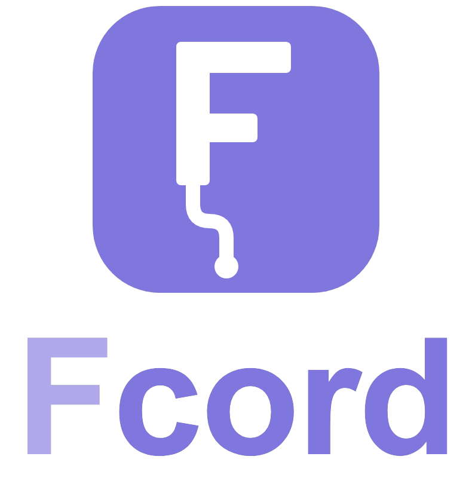

# FCord

FCord adds a configurable plugin catalog, themes, profile customization and optional media tools to the official Discord client. Developed by [Fahd](https://github.com/ellecrydansmesdm).

[Download FCord 1.3.2 for Windows x64](https://github.com/ellecrydansmesdm/Fcord/releases/download/v1.3.2/FCord-Setup-1.3.2.exe) · [Release notes](https://github.com/ellecrydansmesdm/Fcord/releases/tag/v1.3.2) · [Community support](https://discord.gg/W2YgEStqJ4)

## Current release

FCord **1.3.2, revision 8** uses the Tauri 2 installer and the shared Rust installation engine. The Windows installer contains the full runtime payload. This release addresses installation recovery, Discord channel identity, update reinjection and several interface regressions.

| Available asset | Purpose |
| --- | --- |
| [FCord-Setup-1.3.2.exe](https://github.com/ellecrydansmesdm/Fcord/releases/download/v1.3.2/FCord-Setup-1.3.2.exe) | Windows x64 installer with Install, Repair and Uninstall |
| [fcord-dist.zip](https://github.com/ellecrydansmesdm/Fcord/releases/download/v1.3.2/fcord-dist.zip) | Full Windows x64 payload used by the installer and in-client updater |
| [checksums.txt](https://github.com/ellecrydansmesdm/Fcord/releases/download/v1.3.2/checksums.txt) | SHA-256 hashes of the selected release files |
| [release-manifest.json](https://github.com/ellecrydansmesdm/Fcord/releases/download/v1.3.2/release-manifest.json) | Ed25519-signed update metadata |
| [download-manifest.json](https://github.com/ellecrydansmesdm/Fcord/releases/download/v1.3.2/download-manifest.json) | Machine-readable download selection |

Only the assets attached to this version are part of its validated distribution. macOS, Linux, ARM64-native and browser packages are not included in this Windows release. Older packages remain associated with their original releases.

## Install or repair

1. Install the official Discord channel you use, and open it once. Stable, Canary and PTB are supported by the Windows installer.
2. Close the Discord clients using FCord before changing the shared runtime. Keep your settings and original Discord module folders.
3. Download the versioned Setup above and compare its SHA-256 with `checksums.txt`.
4. Run Setup, select the intended Discord channel or validated custom installation, then choose **Install**. Use **Repair** for an existing damaged FCord installation.
5. Open Discord and find FCord in User Settings. If authentication is requested, sign in yourself in the official Discord window.

The interface requires Microsoft Edge WebView2. The release's manifests are Ed25519-signed; the Windows executable has no Authenticode signature. Do not disable antivirus or delete Discord modules to work around an installation failure. Preserve the diagnostic and use Repair or support.

The installer normally shares FCord code across channels while retaining channel-specific preferences and Discord profiles. It does not copy account sessions between Stable, Canary and PTB. Repairs preserve existing settings, original Discord archives and native modules; an unknown third-party loader is refused for explicit recovery rather than overwritten.

## Updates and removal

Use the in-client updater or the new versioned installer. Users on a damaged 1.3.0/1.3.1 installation can run **Repair** with 1.3.2. If Discord cannot open, close that client and run Setup directly.

**Uninstall** restores native Discord for the selected channel. Personal Discord data and FCord settings are retained. Do not manually remove `app.asar`, `_app.asar`, `build_info.json` or module folders.

Public release assets are immutable. A later correction receives a new public version; an existing EXE is not silently replaced under the same tag.

## Known limits

- AudioLimiter's native processing is unavailable. Its inactive desktop controls are disabled and are not presented as a working limiter.
- EditUsers pronoun editing remains incomplete. Some optional plugin actions still require further runtime verification.
- The Studio interaction checks cover navigation, presets, parameter changes, bypass and profile persistence; they do not certify microphone hardware or every audio processing configuration.
- The historical 54-entry audit is not a certification of the entire plugin catalog. See the release notes for the exact validation scope and remaining issues.

## Support

Report the FCord version/revision, Discord channel/version, the operation attempted and the displayed error through [community support](https://discord.gg/W2YgEStqJ4). A sanitized installation diagnostic is useful. Never send a Discord token, password, cookie, session folder or two-factor code.

[Website](https://fhubcore.dev/) · [All releases](https://github.com/ellecrydansmesdm/Fcord/releases)
